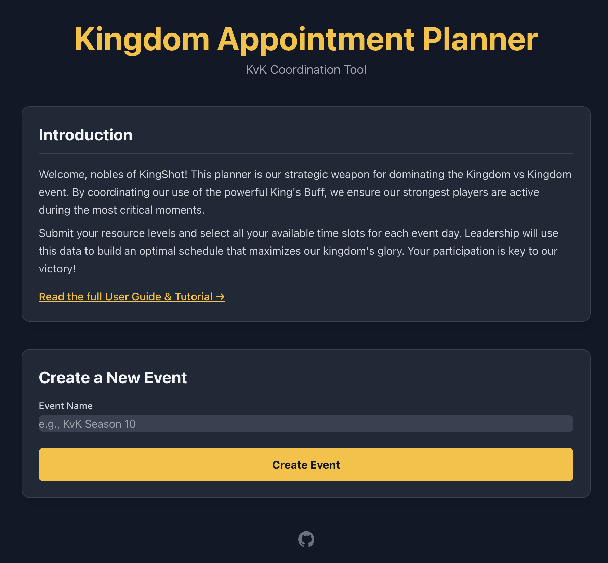
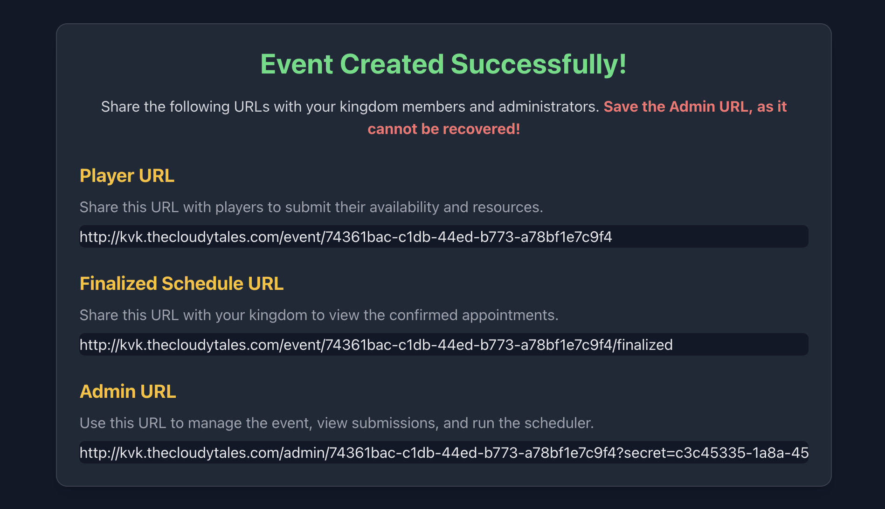
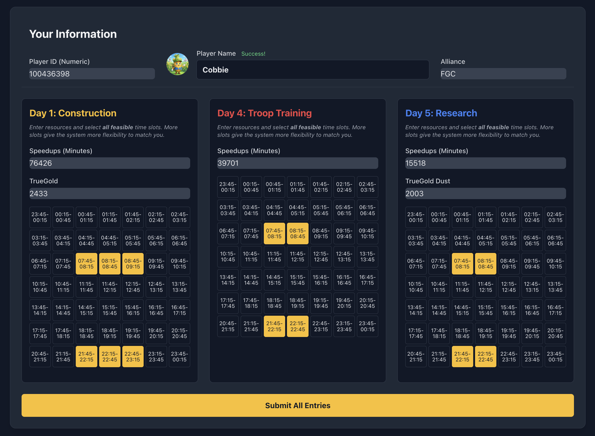
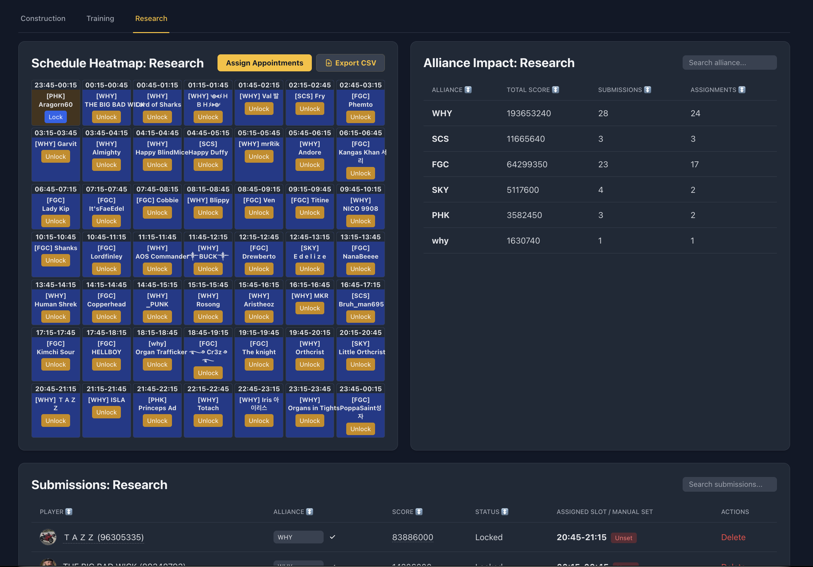
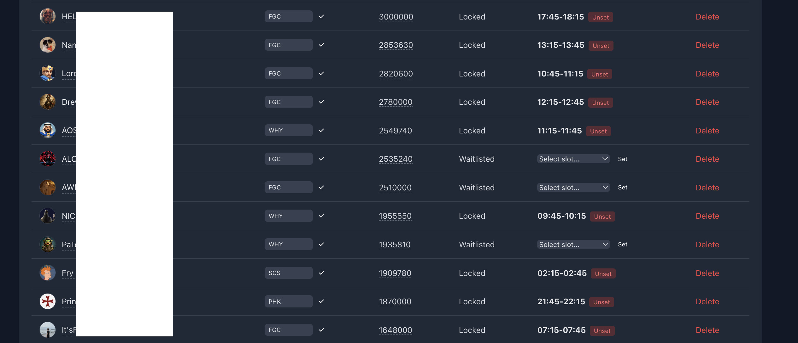
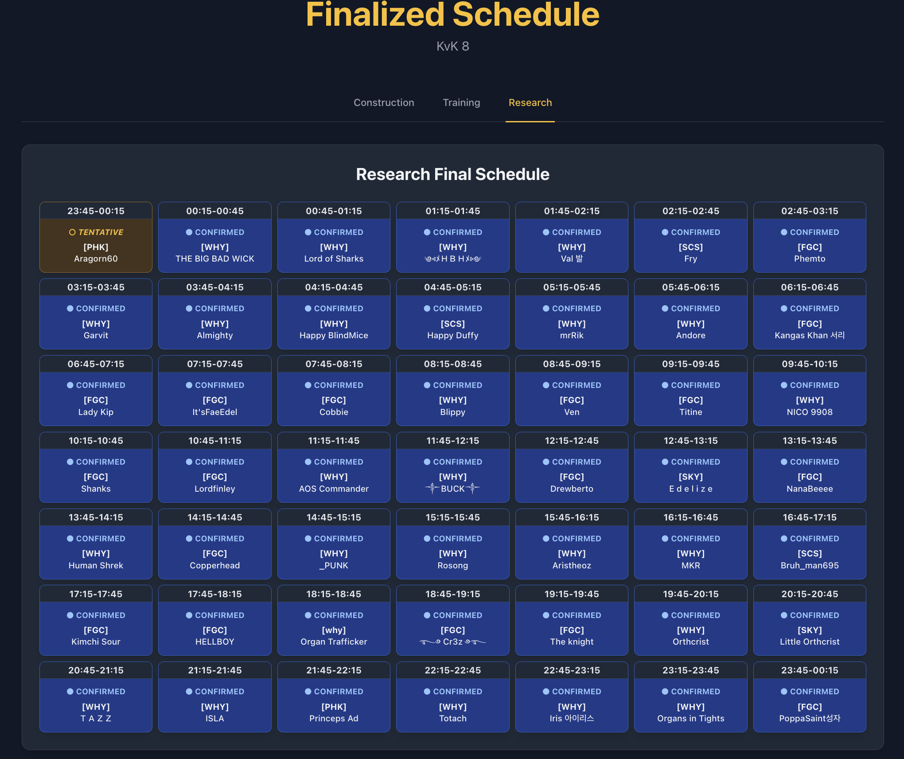

# 👑 KvK Planner

### *Plan the whole KvK: prep week appointments and the castle battle, from one link*

[](https://opensource.org/licenses/MIT)
[](https://www.python.org/downloads/)
[](https://www.docker.com/)

In **Kingdom vs Kingdom** a season has two halves, and until now they were planned in two
different places. **KvK Planner** covers both. **Prep week** collects resource levels and
schedules the King's Buff appointments across construction, research and training.
**Battle day** collects who is online in each hour and what troops they can actually field,
then helps leadership split the server into teams and hand out Sanctuary and Fortress rewards.

Members get **one link** and fill in both. Leadership gets a planning view for each.



---

## 🔗 The five links

Creating a whole-KvK event hands you five URLs:

| # | Link | Who gets it |
| :- | :--- | :--- |
| 1 | **Player link** | Everyone. Prep week and battle day sit behind it. |
| 2 | **Prep planning** | Leadership only — carries the admin key. |
| 3 | **Prep schedule** | Everyone. The confirmed appointments. |
| 4 | **Battle planning** | Leadership only — carries the admin key. |
| 5 | **Battle line-up** | Everyone, once leadership publishes it. Closed by default, so the plan does not leak. |

You can still create a prep-only or battle-only event if you want just one half.

---

## 🎯 Why Use the Planner?

Managing a kingdom of hundreds of players manually is a nightmare. This tool automates the heavy lifting:

*   **Eliminate Spreadsheet Fatigue:** No more manual data entry or juggling conflicting time zones.
*   **Optimal Resource Utilization:** The "Protected Greedy Algorithm" assigns the players with the highest potential point contribution.
*   **Fair & Transparent:** Clear, publicly accessible schedules ensure everyone knows when it's their time to shine.
*   **Full Admin Control:** Balance automation with manual overrides for high-priority VIPs or special circumstances.

---

## ✨ Key Features

### Prep week

| Feature | Description |
| :--- | :--- |
| **Auto-Fetching** | Players enter their ID; the tool fetches their name and avatar directly from the game. |
| **Smart Scheduling** | Prioritizes players based on Speedups, TrueGold, and availability. |
| **Multi-Day Support** | Independent schedules for Construction (Day 1), Training (Day 4), and Research (Day 2 or 5). |
| **Manual Overrides** | Lock automated assignments or set specific players to specific slots. |
| **Verification System** | Players can upload backpack screenshots for admins to verify resource claims. |

### Battle day

| Feature | Description |
| :--- | :--- |
| **Availability by hour** | Who is online in each hour of the battle window, with the drop-off made visible. |
| **Tier per troop type** | Infantry, cavalry and archers separately — and a **Full TG5** check, because a player whose best type is TG5 may still be a tier short elsewhere. |
| **Three teams out of the box** | Castle, Turret and Counter Rally, each with its own tier floor, required hours, size and rally-lead cap. All editable mid-event. |
| **Relay slots** | Two players who each cover part of the window and hand over. Flagged by leadership, exempt from the hour rule. |
| **Late-only bucket** | Members who only show up for the closing hours are listed, not silently dropped. |
| **Rally-lead gap warning** | Says so when a team still has bodies in an hour but no lead. |
| **Alias merging** | `KingOfClubs = Pugs`. One person who votes under one name and submits under another stops being two half-players. |
| **Data warnings** | Duplicate names, one ID on two accounts, and joke IDs that pass the digit check. |
| **Rewards** | Sanctuary and Fortress pieces with per-player caps, tier floors and required hours; leftovers stay leftovers until you assign them. |
| **CSV export** | The whole dashboard as one file. |
| **Public line-up** | A read-only team page you open when the plan is final. |

---

## 📸 A Visual Tour

### 1. Simple Event Setup
Create a new KvK event in seconds. You'll receive five unique links: one for players, two public pages, and two (secret!) planning views for you.


### 2. Player-Friendly Submissions
A clean interface where players can submit their resource levels and all feasible time slots across all three major KvK days. **Tip:** If your resource levels change, just submit again—your record will be updated automatically!


### 3. Powerful Admin Dashboard
See a live heatmap of your schedule and a breakdown of alliance impact. The "Assign Appointments" button runs our optimization algorithm in real-time.


### 4. Precision Control
Need to make a quick change? Manually assign players or lock existing appointments to protect them from future auto-shuffles.


### 5. The Finalized Schedule
When you're ready, publish a beautiful, mobile-friendly schedule that the entire kingdom can access.


---

## 🧠 The "Protected Greedy" Algorithm

To ensure the Kingdom generates the absolute maximum points during KvK, the planner uses a specialized optimization strategy:

1.  **Scoring:** Every player is assigned a "Potential Score" based on their available speedups and rare resources (like TrueGold).
2.  **Ranking:** The algorithm sorts all submissions from highest score to lowest.
3.  **Greedy Assignment:** Starting with the highest-ranked player, the system searches for an open slot that matches the player's submitted availability.
4.  **Protection (Locking):** Administrators can "Lock" any appointment. The algorithm treats locked slots as immutable—it will never move a locked player, even if a higher-scoring player becomes available later. This allows leadership to guarantee slots for critical contributors while letting the algorithm handle the rest.

---

## 📖 Administrator's Guide

### Step 1: Launch your Event
Give your event a name (e.g., "KvK Season 12") and select whether your kingdom runs Research on **Day 2** or **Day 5**. Save the **Admin URL**—this is your private key!

### Step 2: Data Collection & Verification
Share the **Player URL** with your kingdom. 

*   **Verification:** Encourage players to upload screenshots of their backpack. You can view these images directly in the Admin Dashboard to verify their resource claims.
*   **Live Updates:** If a player earns more speedups, they can simply use the link again. The system recognizes their Player ID and updates their existing entry.

### Step 3: Optimization
Click **Assign Appointments**. The system will fill the slots, prioritizing players with the most resources. Review the results, make manual tweaks if needed, and "Lock" the slots you are happy with.

### Step 4: Go Live!
Share the **Finalized Schedule URL**. It's read-only and always reflects your latest locked/assigned appointments.

---

## 🚀 Quick Start (Docker)

The application is fully containerized for a one-command deployment.

*   **Clone the Repository:**
```bash
git clone https://github.com/prashmohan/kingdom-appt-planner.git
cd kingdom-appt-planner
```

*   **Configure Environment Variables:**
```bash
cp .env.example .env
# Set a custom SECRET_KEY and SUPERADMIN_SECRET
```

*   **Launch with Docker Compose:**
```bash
docker-compose up --build -d
```

*   **Access the App:** Open your browser to `http://localhost:12348`.
*   **Superadmin Console:** Visit `http://localhost:12348/superadmin?secret=<YOUR_SUPERADMIN_SECRET>`.

---

## 💾 Maintenance & Backups

Keep your data safe with our included utility script:

*   **Backup:** `./scripts/db_util.sh backup`
*   **Restore:** `./scripts/db_util.sh restore backups/planner_backup_TIMESTAMP.db`

---

## 🛡️ Security & Access Control

*   **Event Admin URLs:** Each event has a unique secret key (`/admin/<uid>?secret=<admin_secret>`). Treat it with care—anyone with this link has administrative control over that event.
*   **Superadmin Console:** Access to `/superadmin` is governed by `SUPERADMIN_SECRET`. It uses session-based authentication and sanitizes the secret from URL history after login. Individual event admin keys cannot access the superadmin interface.

---

*Built with ❤️ for the KingShot community. Dominate your KvK!* ⚔️
